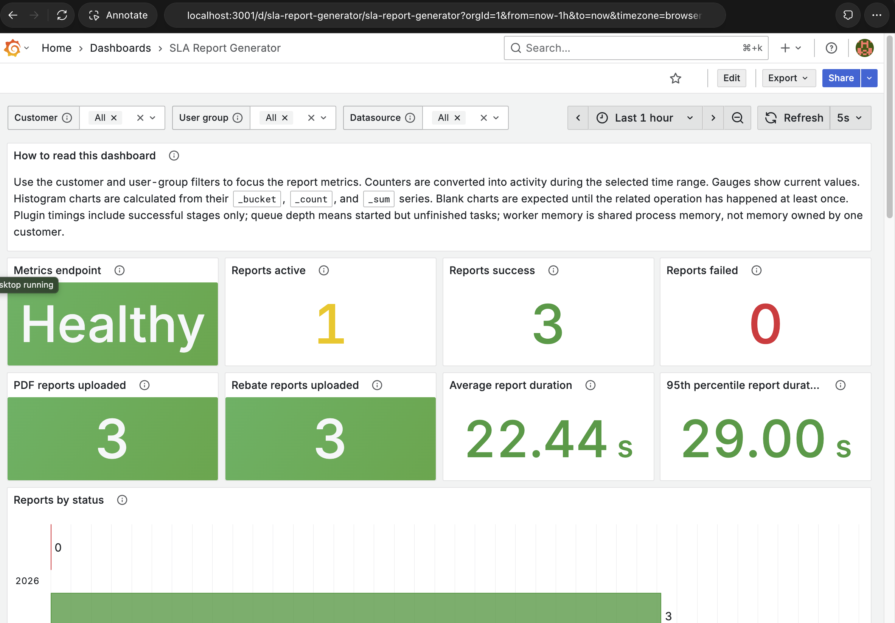

# SLA Report Generator Dashboard Example

This example demonstrates the Grafana dashboard for the SLA Report Generator,
a PCA component that generates SLA reports using Celery workers.

The example is self-contained within this directory. It starts Prometheus and
the Grafana image built from this repository, so a developer does not need the
SLA Report Generator source repository to verify that the dashboard and
datasource provisioning work.

## What the Example Starts

The Compose stack contains:

- Grafana on <http://localhost:3001>
- Prometheus on <http://localhost:9091/prometheus>
- a Prometheus scrape target for
  `http://host.docker.internal:8000/metrics`

The example Prometheus server uses the production `/prometheus` route prefix.
This means the unmodified Swarm datasource packaged in the Grafana image can
connect to `http://prometheus:9090/prometheus`, just as it does in production.

Grafana and Prometheus use temporary memory-backed data directories. Stopping
the Compose stack removes all demonstration data.

## Prerequisites

- Docker with Docker Compose
- access to the private GCR base image used by this repository
- `curl` and `jq` for the optional verification commands

Run the following commands from the root of the `grafana-docker` repository.

## Build the Grafana Image

Build the same Grafana image contents that will be deployed. The explicit
platform allows the production architecture to be tested from an Apple Silicon
development machine:

```bash
make docker \
  DOCKER_VER=sla-dashboard-local \
  LOCAL_BUILD_PLATFORM=linux/amd64
```

Authenticate Docker with GCR first if the private base image cannot be pulled.

## Start the Demonstration

```bash
docker compose \
  -f examples/sla-report-generator/compose.yml \
  up -d
```

Open <http://localhost:3001> and sign in with:

```text
Username: admin
Password: grafana-local-only
```

Open the dashboard directly at:

<http://localhost:3001/d/sla-report-generator/sla-report-generator>

## Verify the Prometheus Datasource

Confirm that Grafana can query the Prometheus API:

```bash
curl -fsS \
  -u admin:grafana-local-only \
  http://localhost:3001/api/datasources/uid/prometheus/health | jq
```

The response should include:

```json
{
  "message": "Successfully queried the Prometheus API.",
  "status": "OK"
}
```

## Verify the Dashboard

Confirm that the dashboard was provisioned from the locally built image:

```bash
curl -fsS \
  -u admin:grafana-local-only \
  http://localhost:3001/api/dashboards/uid/sla-report-generator \
  | jq '.dashboard | {title, uid, panels: (.panels | length)}'
```

Expected result:

```json
{
  "title": "SLA Report Generator",
  "uid": "sla-report-generator",
  "panels": 19
}
```

## Display Real Metrics

The demonstration does not require the SLA Report Generator to be running.
Without it, the dashboard is still provisioned correctly, but stat panels show
zero and some charts remain empty.

To display real application metrics, an SLA Report Generator worker must expose
its metrics endpoint on host port `8000`:

```text
http://host.docker.internal:8000/metrics
```

Check the Prometheus scrape target with:

```bash
curl -fsS \
  http://localhost:9091/prometheus/api/v1/targets \
  | jq '.data.activeTargets[]
      | select(.labels.job == "sla-report-generator")
      | {health, lastError, scrapeUrl}'
```

When the worker is available, the target should report `"health": "up"`.

## Dashboard Tiles

The dashboard contains 19 tiles. The customer, user-group, and datasource
variables can be used to focus relevant metrics.

| Tile | Prometheus metric | What it represents |
| --- | --- | --- |
| How to read this dashboard | None | Guidance explaining the dashboard filters, counters, gauges, histograms, queue depth, and memory values. |
| Metrics endpoint | `up` | Whether Prometheus can currently scrape the SLA Report Generator metrics endpoint. |
| Reports active | `report_in_progress` | The current number of reports being generated for the selected customer and user group. |
| Reports success | `report_total{status="success"}` | Reports that completed successfully during the selected time range. |
| Reports failed | `report_total{status="failure"}` | Reports that failed during the selected time range. |
| Reports by status | `report_total` | A comparison of report outcomes grouped by status. |
| Average report duration | `report_generation_duration_seconds_sum` and `_count` | The mean time taken to generate a report during the selected time range. |
| 95th percentile report duration | `report_generation_duration_seconds_bucket` | The duration within which 95% of report generations completed. |
| Average plugin duration | `plugin_step_duration_seconds_sum` and `_count` | The mean execution time of each SLA Report Generator plugin. |
| Active reports over time | `report_in_progress` | How the number of concurrently active reports changes over time. |
| Average datasource duration | `datasource_query_duration_seconds_sum` and `_count` | The mean query duration for each datasource, such as Druid, CWM, or Gather. |
| Task and worker memory | `task_memory_bytes` and `worker_memory_bytes` | Memory consumption of report tasks and Celery worker processes in MiB. |
| 95th percentile queue wait | `task_wait_time_seconds_bucket` | The queue delay within which 95% of tasks started processing. |
| Druid retries | `druid_sql_retries_total` and `druid_sql_retry_exhaustion_total` | Druid SQL retry attempts and retries that were exhausted, grouped by query pattern and failure category. |
| Progress publication failures | `report_progress_publish_total{outcome="failure"}` | Failed attempts to publish report progress updates. |
| Progress publication successes | `report_progress_publish_total{outcome="success"}` | Successful report progress updates. |
| PDF reports uploaded | `report_upload_total{destination="weld", artifact="pdf", outcome="success"}` | PDF reports successfully uploaded to the Weld Data API. |
| Rebate reports uploaded | `report_upload_total{destination="weld", artifact="rebate_json", outcome="success"}` | Rebate JSON reports successfully uploaded to the Weld Data API. |
| CWM authentication activity | `sla_cwm_auth_events_total` | CWM authentication events grouped by event type during the selected time range. |

## Stop the Demonstration

```bash
docker compose \
  -f examples/sla-report-generator/compose.yml \
  down
```

## Example Dashboard Layout



