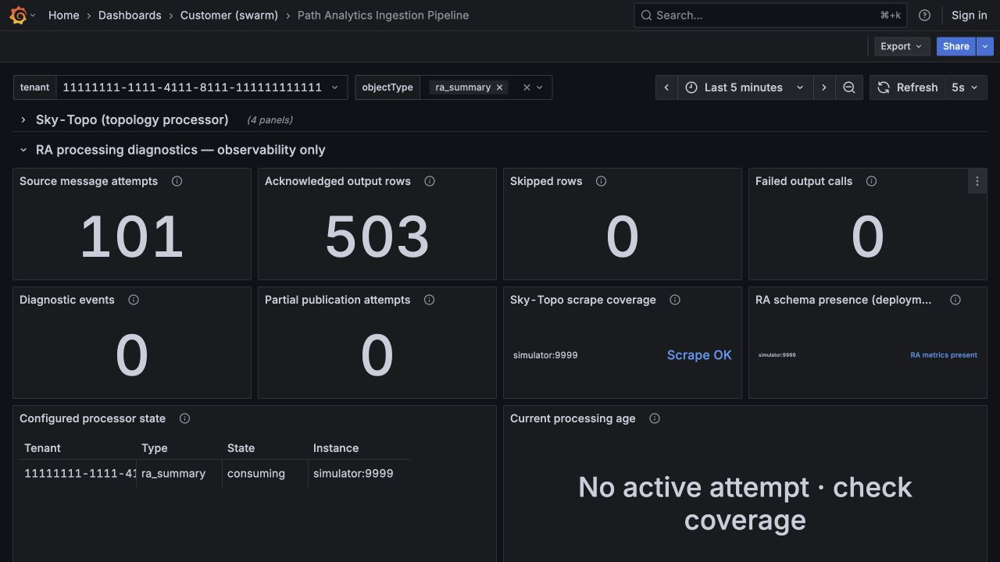
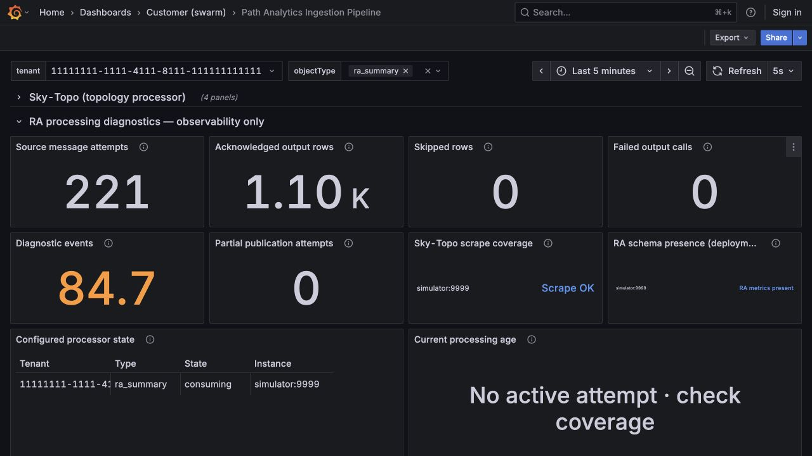
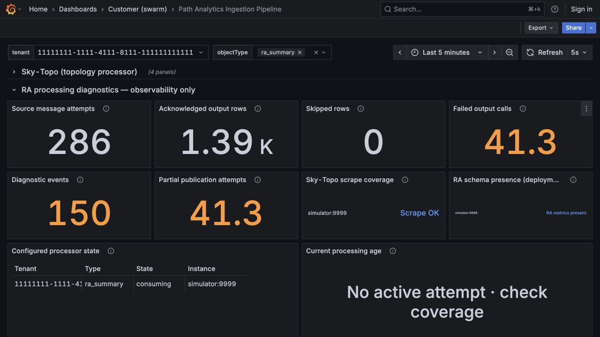
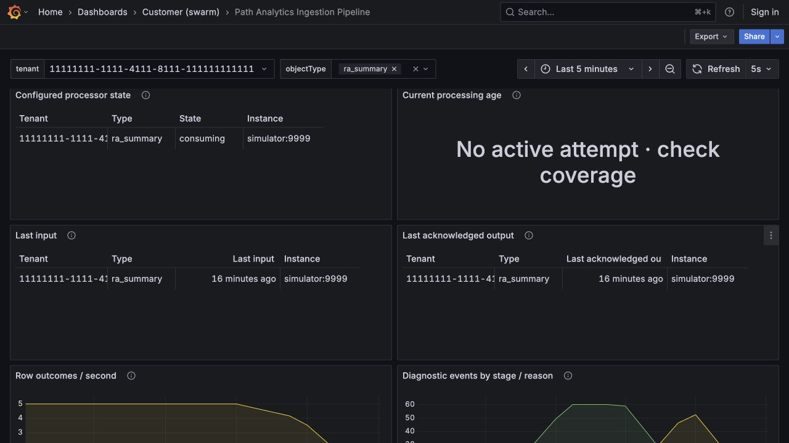
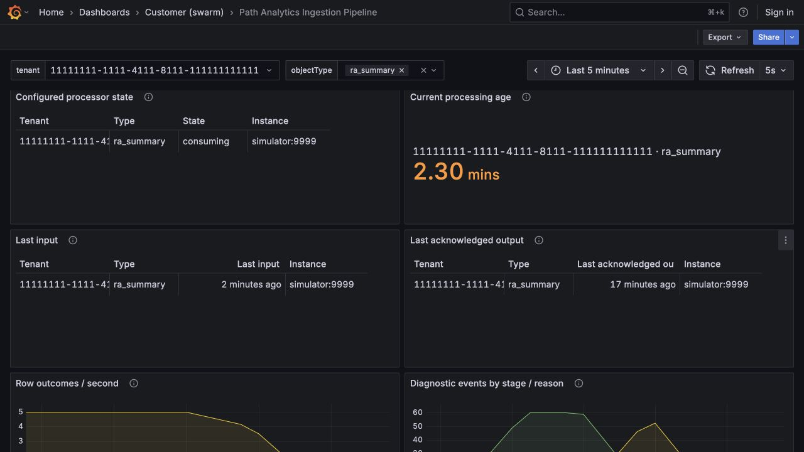
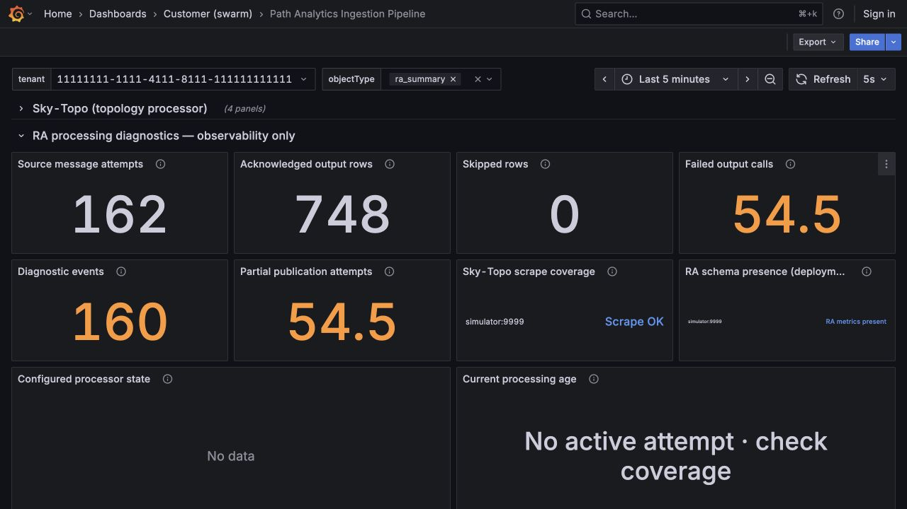
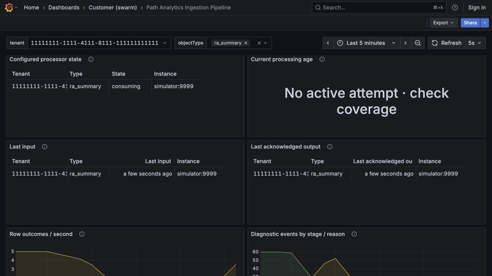

# Path Analytics observability demo

This walkthrough shows how the Path Analytics dashboard distinguishes valid traffic, data-quality diagnostics, failed publication, idle processing, a stalled attempt and missing telemetry. The screenshots come from the real local Grafana 12.1.0 and Prometheus QA stack, using synthetic RA metrics. They do not demonstrate delivery to Kafka or Druid.

Captured on 2026-11-17 from the unpublished `codex/pa07-observability-20261116` branch. Each image has a companion JSON file containing the scenario, scope, dashboard checksum, capture time, exact PromQL and returned samples. Samples were collected close to each screenshot, while the fixture continued running. JSON counters are cumulative; most dashboard cards show a five-minute `increase()`. Those numbers use different calculations and are not expected to match exactly.

## Start the demo

Prerequisites: Docker with Compose, Python 3.9+ with venv, and access to the pinned public images and Python wheels. Run from the `grafana-docker` checkout root:

```bash
make pa07-qa-up
```

For a clean first screenshot, run `make pa07-qa-down` before starting again. This removes only the synthetic QA project's transient history. Reusing a running stack retains its earlier fault window, as described below.

Open the [scoped Path Analytics dashboard](http://127.0.0.1:13000/d/pca-pa-ingestion-pipeline?var-tenant=11111111-1111-4111-8111-111111111111&var-objectType=ra_summary&from=now-5m&to=now&refresh=5s). No login is needed for this loopback-only synthetic fixture. Scroll to **RA processing diagnostics — observability only**.

Keep tenant `11111111-1111-4111-8111-111111111111`, object type `ra_summary`, **Last 5 minutes**, and refresh **5s**. All faults below target this source; the other synthetic sources stay healthy.

Paste this helper into Bash or Zsh. It accepts only the finite demo scenarios and changes only the local simulator:

```bash
pa07_scenario() {
  case "${1:-}" in
    healthy-active|numeric-quality|partial-publication|idle|stalled|metrics-missing|recovery) ;;
    *) printf '%s\n' 'Choose a scenario listed in the demo.' >&2; return 2 ;;
  esac
  curl --fail-with-body --silent --show-error \
    -H 'Content-Type: application/json' \
    --data "{\"dashboard\":\"Customer (swarm)/pca-pa-ingestion-pipeline.json\",\"scenario\":\"pa07-$1\"}" \
    http://127.0.0.1:19999/api/scenario || return
  printf '\n'
}
```

After each selection, allow about 20 seconds for multiple 5-second scrapes and a Grafana refresh. The first screen also needs at least two scrape samples. A single source message can contain several rows, so the two counts are deliberately different. `increase()` extrapolates across the time window; fractional values are expected.

The idle and stalled fixtures deliberately backdate activity gauges to keep the walkthrough short. Their old timestamps are synthetic scenario inputs; you do not need to wait 15 minutes to produce the idle screen.

Counters retain history across scenario changes. A five-minute error card can remain positive after recovery. Use current rates, activity and the underlying counter deltas to determine whether a fault continues; do not reset counters to make the dashboard green.

## 1 Valid traffic

```bash
pa07_scenario healthy-active
```

**Read:** source attempts and acknowledged output rows increase. Skipped rows, failed output calls, diagnostics and partial publications are zero in the clean initial window. Scrape coverage is healthy, the processor is consuming, and there may be no active attempt between short processing calls. This is compatible with healthy activity.



[Prometheus samples](assets/pa07-demo/01-healthy.json)

## 2 A bad number can still be published

```bash
pa07_scenario numeric-quality
```

**Read:** **Diagnostic events** increases while **Skipped rows** and **Failed output calls** remain zero. Output continues. The stage/reason breakdown identifies `numeric / invalid_float`. The existing converter can coerce a bad number and still publish; a diagnostic event is therefore not automatically a lost row.



[Prometheus samples](assets/pa07-demo/02-numeric-quality.json)

## 3 Some output succeeds and some fails

```bash
pa07_scenario partial-publication
```

**Read:** acknowledged rows continue, but **Failed output calls** and **Partial publication attempts** also increase. The breakdown now includes `publish / kafka_output_failed`. The earlier numeric diagnostics remain in the selected time window.

Partial publication signals a source attempt with both successful and failed output calls. It is a replay/duplicate risk signal, not a duplicate count or a guarantee that a failed call never reached Kafka. The MVP does not introduce a retry worker, replay command or DLQ.



[Prometheus samples](assets/pa07-demo/03-partial-publication.json)

## 4 Idle is different from stalled

```bash
pa07_scenario idle
```

Scroll slightly lower to the processor state and activity tables. **Read:** state is consuming, **Current processing age** has no active attempt, and last input/output are around 15 minutes old. Source counters stop growing. Old timestamps alone do not prove a processing stall.



[Prometheus samples](assets/pa07-demo/04-idle.json)

Then select an actually active, old attempt:

```bash
pa07_scenario stalled
```

**Read:** **Current processing age** is now positive and above two minutes. Unlike idle, a source attempt is in progress. Check scrape coverage and the current start timestamp before diagnosing a stall; the consuming state alone does not prove progress.



[Prometheus samples](assets/pa07-demo/05-stalled.json)

## 5 Missing telemetry is not zero errors

```bash
pa07_scenario metrics-missing
```

**Read:** the selected source's instant state/activity series disappear, while **Sky-Topo scrape coverage** stays healthy. The deployment schema panel can still say **RA metrics present**, because other sources remain present. This panel is deployment-scoped; it does not certify that the selected source is instrumented or configured.

Windowed `increase()` cards and graphs can retain older samples until they age out. Do not expect every panel to become No data immediately. Query the current source series to confirm absence. Absence must not be reported as healthy zero failures.



[Prometheus samples](assets/pa07-demo/06-metrics-missing.json)

## 6 Recovery

```bash
pa07_scenario recovery
```

**Read:** the state and recent input/output return, and the source/output counters resume increasing. Failure totals do not reset. A positive five-minute diagnostic count can still describe the earlier fault, so compare successive raw counters or wait for a fault-free window.



[Prometheus samples](assets/pa07-demo/07-recovery.json)

## Verify the samples yourself

The scenario endpoint returning HTTP 200 proves only that the control was accepted. Check the observations in Prometheus:

```bash
curl --fail-with-body --silent --show-error --get \
  http://127.0.0.1:19090/api/v1/query \
  --data-urlencode 'query=sky_topo_ra_failures_total{tenant_id="11111111-1111-4111-8111-111111111111",record_type="ra_summary"}'

curl --fail-with-body --silent --show-error --get \
  http://127.0.0.1:19090/api/v1/query \
  --data-urlencode 'query=sky_topo_ra_processing_started_timestamp_seconds{tenant_id="11111111-1111-4111-8111-111111111111",record_type="ra_summary"}'

curl --fail-with-body --silent --show-error --get \
  http://127.0.0.1:19090/api/v1/query \
  --data-urlencode 'query=up{job="sky-topo"}'
```

The processing-start sample is `0` when idle, a Unix timestamp while active, and absent for the selected metrics-missing fixture. `up` remains `1` for all scenarios above. A real scrape failure is a separate test.

## Reproduce the automated checks

From `grafana-docker`:

```bash
make test-observability
make pa07-qa-test
```

The first command runs the Python suite and real offline PromQL parser. The second repeats that suite, then checks the running Prometheus/Grafana fixture and briefly stops/restarts only its simulator to verify actual `up=0` and recovery. It changes the displayed scenario. Full details and G-01–G-09 are in the [local Grafana test plan](pa07-observability-test-plan.md).

For actual RA processing and Kafka offsets, run from the sibling `sky-topo` checkout:

```bash
tests/ra-observability.sh
```

That launcher creates an owned disposable Kafka broker on loopback port 19092, runs four Go packages with `-race`, checks both RA types and committed offsets, and cleans up its fixture. The companion plan is `sky-topo/manualtestplans/pa07-observability-test-plan.md`, cases L-01–L-11. These broker tests are separate from this synthetic dashboard demo.

## Stop the local demo

From `grafana-docker`:

```bash
make pa07-qa-down
```

Only the named `pa07-observability` Compose project is stopped and removed. No remote PCA deployment, inventory, collector, Kafka offsets or Druid data is changed.
